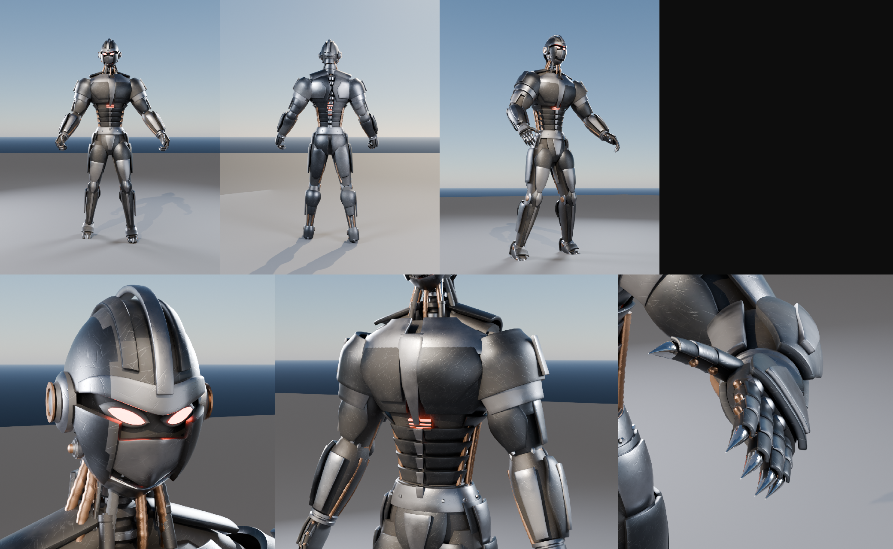

# SENTINEL — боевой андроид (оригинальный персонаж)

Высокодетализированная 3D-модель тяжёлого боевого андроида. Модель полностью готова для игры: скелет, скиннинг, PBR-материалы, анимации, LOD.
Дизайн оригинальный: тёмная многослойная сталь, открытая механика торса, бронзовые кабели, красные светящиеся глаза.



## Файлы

| Путь | Что это |
|---|---|
| `source/sentinel.blend` | Исходный проект Blender: меш, скелет с IK-заготовками, материалы, 9 анимаций (Actions + NLA) |
| `export/sentinel.glb` | LOD0 (~253k треугольников), скелет, все анимации, текстуры встроены |
| `export/sentinel_lod1.glb` | LOD1 (~76k треугольников) для игрового рантайма |
| `export/sentinel.fbx` | FBX для Unity/Unreal: меш, скелет, все анимации, встроенные base color и normal |
| `textures/` | PBR-карты 1024² (тайлящиеся): `*_BaseColor`, `*_ORM` (R=AO, G=Roughness, B=Metallic), `T_Armor_N`, `T_Mech_N` |
| `renders/` | Превью-рендеры Cycles |
| `viewer.html` | Веб-просмотрщик (three.js): вращение, анимации, скелет, сетка, LOD |
| `scripts/build_sentinel.py` | Процедурный генератор модели (полностью воспроизводимый) |
| `scripts/render_previews.py` | Рендер превью |
| `scripts/validate.py` | Автоматическая проверка геометрии, весов, материалов, скелета и экспортов |

## Характеристики

- **Геометрия:** 510 отдельных элементов брони и механики, объединённых в один скинированный меш. Каждая пластина — лофт супер-эллипса с реальной толщиной и фасками, без «кубов». Элементы:
  - голова: шлем с гребнем, надбровная пластина, лицевая маска, подвижная челюсть, щёчные пластины, височные диски, вентиляционные ламели;
  - шея: позвонки, 10 гофрированных кабелей, гидравлика;
  - грудь: многослойная броня, киль, вент;
  - торс: открытый пресс из ламелей и внутренний позвоночник;
  - спина: лопаточные пластины, гребень позвоночника, светящиеся вентиляционные решётки;
  - руки: трёхслойные наплечники, гидравлические поршни, шарниры с проточками, сегментированные пальцы с когтями;
  - ноги: многослойные бёдра, наколенники, голени с открытой икроножной механикой, ступни с подошвой и сегментированными носками.
- **Материалы (8):** Gunmetal (основная броня), Steel (акценты), Mech (внутренняя механика), Bronze (кабели и втулки), Chrome (штоки и когти), Rubber, Eye Emissive, Glow Emissive.
  Текстуры содержат царапины, сколы, грязь и вмятины; roughness варьируется. UV — мировая box-проекция с единой плотностью текселей.
- **Скелет:** 57 деформирующих костей (root → hips → spine ×3 → neck ×2 → head → jaw/eyes; clavicle/upperarm/forearm/hand; по 3 фаланги на каждый палец + большой; thigh/shin/foot/ball). Плюс 8 управляющих IK-костей: IK-ограничения есть, но выключены (`mute`).
  Броня привязана к костям жёстко (правильно для механического тела). Кабели и ядра торса смешивают веса между костями. Не больше 4 влияний на вершину, сумма весов = 1.
- **Анимации (in-place, 24 fps):** `Idle`, `Walk`, `Run`, `Combat_Combo` (кросс + удар когтями), `Talk` (челюсть + жесты), `Head_Look`, `Hand_Fist`, `Pose_Hero`, `Pose_Menace`.
- **Ориентация:** Z-up в Blender, Y-up в glTF; персонаж смотрит в −Y (Blender). Масштаб 1 юнит = 1 м, рост ≈ 2.3 м. Rest-pose — T-поза (удобна для ретаргетинга, например Mixamo / UE5 IK Retargeter).

## Проверка

`python3 scripts/validate.py` → **ALL CHECKS PASSED**:
- 0 незамкнутых рёбер, 0 вырожденных граней, 0 свободных вершин;
- все вершины имеют веса, все группы вершин соответствуют костям;
- ни в одной анимации меш не «разваливается»;
- GLB и FBX реимпортируются с одним мешем, скелетом, материалами и 9 клипами.

## Пересборка

```bash
pip install bpy                     # Blender 5.x как Python-модуль (или запустить через blender -b -P)
python3 scripts/build_sentinel.py   # модель + текстуры + экспорт (~20 с)
python3 scripts/render_previews.py 64
python3 scripts/validate.py
```

## Заметки для движка

- **Unity / Unreal через FBX:** формат FBX не переносит упакованную ORM-карту. Подключите `textures/T_*_ORM.png` вручную: в UE это канал AO/Roughness/Metallic, в Unity HDRP — Mask Map с перестановкой каналов. GLB содержит всё сразу.
- Для эмиссии глаз используйте Bloom/Post-process: сила эмиссии в glTF сохранена через `KHR_materials_emissive_strength`.
- Анимации сделаны «на месте» (in-place). Root motion можно добавить ключами на кость `root`.
